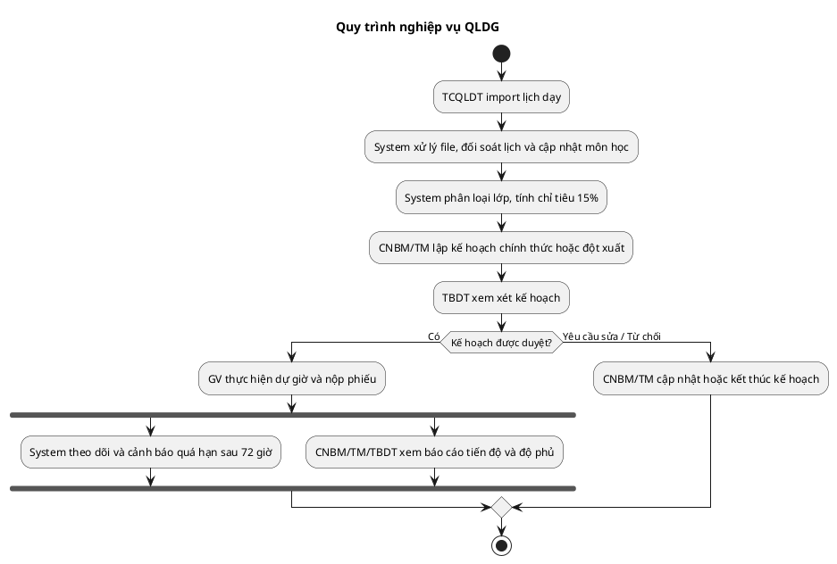

# PHẦN 1: TỔNG QUAN & MÔ HÌNH DÙNG CHUNG (OVERVIEW & COMMON DOMAIN)

## 1.1. Danh sách Actors (Tác nhân)

| Actor | Tên tiếng Việt | Mô tả vai trò |
| --- | --- | --- |
| `HeadOffice` | TC&QLĐT Tập đoàn | **Super Admin**: quản trị/cấu hình chung hệ thống, chuyển đổi cơ sở, tạo cơ sở và cấp/thu hồi quyền Head Office. |
| `TBDT` | Trưởng ban Đào tạo | Quản lý cấp cơ sở; phê duyệt/từ chối kế hoạch dự giờ, lập KH thay khi thiếu CNBM. |
| `TP.ĐT` | Trưởng phòng Đào tạo | Phạm vi xem mọi bộ môn đang bật trong cơ sở (theo overview); quyền duyệt kế hoạch chưa được nguồn giao nên không mặc định cấp. |
| `TCQLDT` | TC&QLĐT Cơ sở | Quản trị dữ liệu nền cơ sở: Giảng viên, Môn học, Cơ cấu bộ môn, Import lịch dạy, Mốc kỳ. |
| `CNBM` | Chủ nhiệm Bộ môn | Quản lý Nhóm bộ môn (theo `group_key`), lập KH dự giờ chính thức/đột xuất, theo dõi tiến độ. |
| `TM` | Trưởng môn | Quản lý 1 Bộ môn con, thực hiện lập KH và xem báo cáo trong phạm vi bộ môn mình. |
| `GV` | Giảng viên | Người được dự giờ hoặc người đi dự giờ (GV1, GV2, GV3), nhập phiếu chấm và xem kết quả. |
| `System` | Hệ thống / Job Nền | Tiến trình xử lý ngầm (Queue, Scheduler, Auto-classification, Warning Service). |

---

## 1.2. Ma trận Phân quyền Use Case

| Mã Use Case | Tên Use Case | HeadOffice | TBDT | TP.ĐT | TCQLDT | CNBM | TM | GV | System |
| --- | --- | --- | --- | --- | --- | --- | --- | --- | --- |
| **UC-01** | Đăng nhập & Chọn cơ sở | x | x |  |  |  |  | x |  |
| **UC-02** | Quản lý Tài khoản / GV | x |  |  | x |  |  |  |  |
| **UC-03** | Cấu hình Cơ cấu Bộ môn | x |  |  | x |  |  |  |  |
| **UC-04** | Cập nhật Kế hoạch Kỳ/Block |  |  |  | x |  |  |  |  |
| **UC-05** | Bổ sung Dữ liệu thiếu |  |  |  | x |  |  |  |  |
| **UC-06** | Quản trị Cơ sở & Quyền HO | x |  |  |  |  |  |  |  |
| **UC-07** | Import File Lịch dạy |  |  |  | x |  |  |  |  |
| **UC-08** | Đối soát & Nhận diện Buổi |  |  |  |  |  |  |  | x |
| **UC-09** | Quản lý Môn học & Đặt tên |  |  |  | x |  |  |  | x |
| **UC-10** | Tự động Phân loại Lớp học |  |  |  |  |  |  |  | x |
| **UC-11** | Lập KH Dự giờ Chính thức |  | x* |  |  | x | x |  |  |
| **UC-12** | Tìm & Phân công Người dự |  | x* |  |  | x | x |  |  |
| **UC-13** | Lập KH Dự giờ Đột xuất |  | x* |  |  | x | x |  |  |
| **UC-14** | Phê duyệt Kế hoạch Dự giờ |  | x |  |  |  |  |  |  |
| **UC-15** | Tra cứu Lịch & Cảnh báo SLA | x | x | x | x | x | x | x | x |
| **UC-16** | Nhập Phiếu Đánh giá Dự giờ |  |  |  |  |  |  | x |  |
| **UC-17** | Trích xuất Phiếu / Kết quả | x | x | x | x | x | x | x |  |
| **UC-18** | Xem Báo cáo Real-time | x | x | x | x | x | x |  |  |

**TBDT có quyền lập KH dự giờ khi bộ môn chưa có CNBM và TM. `TP.ĐT` được xem theo phạm vi bộ môn đang bật trong cơ sở; quyền khác chưa được transfer xác định.**

---

## 1.3. Sơ đồ Tổng quan 

---

## 1.4. Quy tắc Nghiệp vụ Dùng chung (Global Business Rules - GBR)

**GBR-01 (Mô hình Campus-Faculty):**
* `faculties` (20 bộ môn) là toàn cục, dùng chung 14 cơ sở.
* Mối quan hệ Cơ sở - Bộ môn nằm ở `campus_faculty`.
* Bộ môn bị `is_active = false` tại cơ sở sẽ ẩn hoàn toàn khỏi mọi chức năng.
* Các bộ môn có cùng `group_key` tại 1 cơ sở tạo thành 1 Nhóm do **1 CNBM** quản lý. `group_key` độc lập giữa các cơ sở.

**GBR-02 (Phạm vi dữ liệu `my_faculties()`):**
* `HeadOffice` (**Super Admin**): Quản trị/cấu hình chung toàn hệ thống; chuyển cơ sở theo UC-01. Các thao tác tại cơ sở dùng phạm vi cơ sở đang chọn.
* `TBDT` / `TCQLDT`: Xem tất cả bộ môn `is_active = true` của cơ sở hiện tại.
* `CNBM`: Xem tất cả bộ môn con thuộc cùng `group_key` tại cơ sở.
* `TM`: Xem đúng 1 bộ môn được phân công.
* `GV`: Xem dữ liệu liên quan đến mình; bộ môn của môn/lớp mình giảng dạy.
* Vai `TP.ĐT` có trong overview; phạm vi xem là mọi bộ môn đang bật trong cơ sở. Không cấp quyền duyệt kế hoạch vì transfer chưa nêu.

**GBR-03 (Mẫu số tính Chỉ tiêu & Báo cáo):**
* Mọi thống kê / chỉ tiêu 15% đếm theo giảng viên có lớp dạy thực tế (`subject_user` + `subjects.faculty_id`) trong Block, không đếm theo biên chế `users.faculty_id`. Chỉ tính lớp có lịch dạy và giảng viên cùng cơ sở với bộ môn đang xem.
* Chỉ tiêu của nhóm bộ môn = `CEIL(Tổng số GV có lớp dạy trong nhóm x 15%)`.
* Giảng viên đã có trong kế hoạch: đếm DISTINCT trong kế hoạch đã duyệt hoặc hoàn thành. Kế hoạch đột xuất `-DX` vẫn tính người được dự vào chỉ tiêu 15%.
* Dòng "Cả kỳ" đếm giảng viên DISTINCT qua hai Block; một người có ở cả hai Block chỉ tính một lần.
* Báo cáo tính trực tiếp từ dữ liệu gốc mỗi lần mở trang; không dùng bộ đếm cộng dồn.

**GBR-04 (Thang điểm Động):**
* Phiếu hiện có N = 23 câu hỏi; mỗi câu từ 0 đến 4. Điểm tối đa là N × 4 (hiện tại: 92).
* Mốc đạt 75% là N × 4 × 0.75 (hiện tại: 69). Tự tính lại nếu số câu hoặc thang điểm đổi.
* Báo cáo chỉ số GV đạt → 75%: với mỗi giảng viên được dự giờ, lấy trung bình cộng điểm tổng của các phiếu đã nộp; quy đổi theo điểm tối đa hiện hành thành tỷ lệ, rồi so với ngưỡng 75%.

**GBR-05 (Cảnh báo SLA 72 giờ):**
* Buổi thuộc kế hoạch `APPROVED` là quá hạn khi qua ngày dự kiến (hoặc ngày thực tế nếu có) 72 giờ mà GV1/GV2/GV3 được phân công còn thiếu phiếu.
* Số cảnh báo tuân theo bộ lọc kỳ / block / bộ môn đang chọn và phạm vi quản lý người xem.
* **Đề xuất cần xác nhận:** Lấy ngày thực tế nếu có, nếu không lấy ngày dự kiến; SLA tính từ mốc ngày đó + 72 giờ. Nguồn chưa quy định xử lý khi ngày thực tế được cập nhật sau khi cảnh báo đã phát sinh.
---

# PHẦN 2: ĐẶC TẢ CHI TIẾT USE CASES - PHÂN HỆ QUẢN TRỊ & DỮ LIỆU NỀN

### UC-01: Đăng nhập Hệ thống & Chọn Cơ sở

**Actor:** Tất cả Actors

**Mô tả:** Người dùng chọn Cơ sở làm việc và đăng nhập thông qua Google OAuth2 (`@fpt.edu.vn`)

**Pre-conditions:** Tài khoản Google khả dụng

**Main Flow:**

1. Người dùng truy cập trang chủ hệ thống.

2. Hệ thống hiển thị danh sách 14 Cơ sở.

3. Người dùng chọn Cơ sở làm việc (ví dụ: CĐ Đà Nẵng) và bấm "Đăng nhập Google".

4. Hệ thống chuyển hướng đến Google OAuth2.

5. Người dùng xác thực tài khoản email `@fpt.edu.vn`.

6. Hệ thống đối soát cặp `(Email + Cơ sở)`.

7. Hệ thống xác thực thành công, khởi tạo JWT Session chứa `user_id`, `campus_id`, `role`, cấp danh mục Menu theo vai trò và chuyển hướng vào Dashboard.

**Alternate Flows:** 
* *AF-1: Đăng nhập vai HeadOffice:* Người dùng đăng nhập có quyền HeadOffice → Hệ thống hiển thị màn hình chọn/chuyển đổi bất kỳ cơ sở nào trong 14 cơ sở (`/auth/campus`).

**Alternate Flows:**
* **AF-1: Head Office chọn cơ sở:** Sau khi đăng nhập, chuyển tới `/auth/campus`; chọn cơ sở để làm việc trong phạm vi cơ sở đó.
* **AF-2: Chưa có tài khoản tại cơ sở được chọn:** Theo HDSD, hệ thống tự tạo tài khoản tại cơ sở đó.

**Exception Flows:**
* **EF-1: Người dùng thông thường chưa có tài khoản tại cơ sở:** Hệ thống thông báo *"Tài khoản của bạn chưa được cấp quyền tại cơ sở này hoặc bộ môn chưa được bật. Vui lòng liên hệ TC&QLĐT"* và từ chối truy cập.
* `HeadOffice` là Super Admin, quyền hệ thống gắn theo email trên các tài khoản cơ sở. Tài khoản tại cơ sở mới kế thừa quyền này; không tự cấp thêm vai trò cơ sở khác.

**Post-conditions:** Session đăng nhập khởi tạo thành công với phạm vi dữ liệu đúng cơ sở đã chọn.

---

### UC-02: Quản lý Thông tin Giảng viên / Tài khoản

**Actor:** `TCQLDT`, `HeadOffice`.

**Mô tả:** Cho phép tạo mới, cập nhật thông tin nhân sự/giảng viên tại cơ sở.

**Quyền Head Office:** Có thể tạo tài khoản cho cơ sở bất kỳ qua trường **Cơ sở**, không cần chuyển cơ sở. HDSD cũng nói hệ thống tự tạo tài khoản khi Head Office chuyển tới cơ sở chưa có tài khoản.

**Cần xác nhận:** Nguồn chưa quy định các trường/vai trò mặc định khi tự tạo tài khoản khi chuyển cơ sở; xem UC-01/UC-06.

**Pre-conditions:** Actor có quyền `TCQLDT` hoặc `HeadOffice`.

**Main Flow:**

1. Actor truy cập menu **Quản lý thông tin GV** → chọn **Thêm giáo viên**.

2. Actor nhập các trường thông tin:
    * Mã nhân viên (`staff_code`): Chỉ nhận ký tự số `0-9`, lưu dạng chuỗi để giữ số `0` ở đầu (VD: `00246900`).
    * Họ tên: Ít nhất 2 từ.
    * Email: Nhập username, đuôi mặc định `@fpt.edu.vn` (có nút bấm sửa đuôi nếu cần).
    * Vai trò (`role`): Chọn từ danh sách vai trò cho phép (`TBDT`, `TCQLDT`, `CNBM`, `TM`, `GV`). Không có tùy chọn `Admin`.
    * Bộ môn biên chế (`faculty_id`), Kỳ onboard, Loại hợp đồng (Cơ hữu / Thỉnh giảng).

3. Hệ thống validate dữ liệu theo quy định.

4. Hệ thống lưu bản ghi mới vào bảng `users` gắn với `campus_id` hiện tại.

5. Hệ thống hiển thị thông báo thành công.

**Alternate Flows:** * *AF-1: HeadOffice tạo tài khoản:* `HeadOffice` thấy thêm trường dropdown **Cơ sở** để tạo tài khoản cho cơ sở bất kỳ mà không cần chuyển cơ sở.

**Exception Flows:** * *EF-1: Trùng Mã NV trong cùng cơ sở / Sai định dạng Email:* Hệ thống báo lỗi ngay tại form và chặn Submit.

**Post-conditions:** Tài khoản mới được khởi tạo sẵn sàng cho công tác phân công.

---

### UC-03: Cấu hình Cơ cấu Bộ môn theo Cơ sở (`campus_faculty`)

**Actor:** `TCQLDT`, `HeadOffice`

**Mô tả:** Cấu hình bật/tắt bộ môn đào tạo tại cơ sở và gộp nhóm quản lý `group_key`

**Pre-conditions:** Đã chọn cơ sở làm việc

**Main Flow:**

1. Actor truy cập menu **Cơ cấu bộ môn**.

2. Hệ thống tải danh sách 20 bộ môn toàn cục và trạng thái tại cơ sở hiện tại (`campus_faculty`).

3. Actor thực hiện các thao tác:
    * Bật/Tắt công tắc `is_active` cho từng bộ môn.
    * Nhập/sửa mã `group_key` để gộp các bộ môn nhỏ thành 1 Nhóm quản lý (Ví dụ: Gán `CB` cho Cơ bản, Tiếng Anh, Tiếng Trung).
    * Gán tài khoản **CNBM** cho Nhóm `group_key`.
    * Gán tài khoản **Trưởng môn (TM)** cho từng bộ môn con

4. Actor bấm **Lưu cấu hình**.

5. Hệ thống kiểm tra ràng buộc: Mỗi `group_key` tại 1 cơ sở chỉ có tối đa 1 CNBM.

6. Hệ thống lưu vào DB và cập nhật ngay lập tức phạm vi truy cập `my_faculties()`.

**Exception Flows:** * *EF-1: Gán 2 CNBM cho cùng 1 Group Key:* Hệ thống báo lỗi *"Mỗi nhóm quản lý chỉ được phép gán 1 Chủ nhiệm bộ môn"*.

**Post-conditions:** Phạm vi quản lý của CNBM và TM được cập nhật chuẩn xác.

---

### UC-04: Cập nhật Kế hoạch Mốc thời gian Kỳ & Block

**Actor:** `TCQLDT`

**Mô tả:** Cấu hình mốc thời gian bắt đầu và kết thúc của các Kỳ học (Spring, Summer, Fall) và Block (Block 1, Block 2)

**Pre-conditions:** Đã vào kỳ mới

**Main Flow:**

1. Actor truy cập **Cập nhật kế hoạch kỳ**

2. Actor chọn Kỳ học và nhập mốc thời gian:
    * Ngày bắt đầu Kỳ / Ngày kết thúc Kỳ.
    * Ngày bắt đầu & kết thúc Block 1; Ngày bắt đầu & kết thúc Block 2.

3. Hệ thống áp dụng quy tắc ràng buộc logic:

\text{Bắt đầu Kỳ} = \text{Bắt đầu Block 1} < \text{Kết thúc Block 1} < \text{Bắt đầu Block 2} < \text{Kết thúc Block 2} = \text{Kết thúc Kỳ}

4. Hệ thống tự động khóa (read-only) các ô Bắt đầu Kỳ / Kết thúc Kỳ khi đã chọn Block.

5. Actor bấm **Lưu kế hoạch**.

**Exception Flows:** * *EF-1: Nhập ngày Block 2 đè lên ngày Block 1 hoặc sai thứ tự:* Hệ thống từ chối lưu và báo lỗi mốc thời gian không hợp lệ.
* *EF-2: Sửa kỳ đã qua:* Hệ thống khóa hoàn toàn không cho sửa kỳ đã kết thúc.

**Post-conditions:** Mốc thời gian điều khiển toàn bộ bộ lọc Kỳ/Block và tính toán báo cáo trong hệ thống.

---

### UC-05: Bổ sung Dữ liệu Tài khoản thiếu

**Actor:** `TCQLDT`.

**Mô tả:** Điền nhanh thông tin cho các tài khoản giảng viên được sinh tự động từ file import nhưng chưa đủ hồ sơ.

**Pre-conditions:** Hệ thống có bản ghi `users` thiếu trường thông tin bắt buộc.

**Main Flow:**

1. Hệ thống hiển thị badge đỏ kèm số lượng bản ghi thiếu thông tin cạnh menu **Dữ liệu cần bổ sung**.

2. Actor bấm vào menu **Dữ liệu cần bổ sung**.

3. Hệ thống liệt kê danh sách tài khoản chưa đủ: Họ tên, Mã NV, Bộ môn, Kỳ onboard hoặc Loại hợp đồng.

4. Actor điền trực tiếp thông tin vào các ô trống ngay trên bảng danh sách.

5. Actor bấm **Lưu cập nhật**.

6. Hệ thống validate dữ liệu, cập nhật bản ghi `users` và giảm số đếm trên badge đỏ.

**Post-conditions:** Hồ sơ giảng viên đầy đủ điều kiện để thống kê báo cáo chính xác.

---

### UC-06: Quản trị Cơ sở & Cấp quyền Head Office

**Actor:** `HeadOffice`.

**Mô tả:** Tạo cơ sở đào tạo mới và cấp/thu hồi quyền Head Office cho nhân sự.

**Pre-conditions:** Actor đăng nhập bằng tài khoản có quyền Head Office.

**Main Flow (Tạo cơ sở mới):**

1. Actor truy cập **Cơ sở** → **Thêm cơ sở**.

2. Actor nhập Mã cơ sở (viết thường, không dấu, VD: `pd`), Tên cơ sở và Địa chỉ.

3. Actor bấm **Tạo cơ sở**.

4. Hệ thống tự động thực hiện 3 bước:
    * (a) Tạo bản ghi mới trong `campuses`.
    * (b) Khởi tạo 20 bộ môn trong `campus_faculty` ở trạng thái **Tắt tất cả (`is_active = false`)**.
    * (c) Tạo bản ghi `users` cho chính Actor tại cơ sở mới.

**Main Flow (Cấp quyền Head Office):**

1. Actor truy cập **Tài khoản Head Office** → **Cấp quyền**.

2. Actor gõ tìm kiếm tài khoản (theo account, họ tên, email hoặc mã NV).

3. Hệ thống hiển thị xem trước thông tin người được cấp.

4. Actor bấm **Xác nhận cấp quyền**.

5. Hệ thống tìm **tất cả bản ghi tài khoản có cùng Email** trên các cơ sở và gán quyền `HEAD_OFFICE`.

**Lưu ý:** Head Office chuyển tới cơ sở chưa có tài khoản thì hệ thống tự tạo tài khoản tại cơ sở đó (HDSD, mục 6.1). Tài khoản nhận quyền Super Admin theo email.

**Cần xác nhận:** Nguồn chưa quy định các trường được sao chép hoặc vai trò mặc định khi tự tạo tài khoản; cũng chưa mô tả cách xử lý nếu cơ sở đích chưa được khởi tạo.

**Post-conditions:** Cơ sở mới được khởi tạo an toàn (ẩn mọi bộ môn); quyền Super Admin/Head Office được đồng bộ theo email.

---

# PHẦN 3: ĐẶC TẢ CHI TIẾT USE CASES - PHÂN HỆ QUẢN LÝ LỊCH DẠY

### UC-07: Import File Lịch dạy Excel (Asynchronous Import)

**Actor:** `TCQLDT`.

**Mô tả:** Tải file Excel lịch dạy từ hệ thống đào tạo chính lên QLDG. Hệ thống xếp file vào hàng đợi (Queue Task) và tiến trình nền xử lý bất đồng bộ.

**Pre-conditions:** `TCQLDT` đã cấu hình mốc thời gian Kỳ & Block (`UC-04`).

**Main Flow:**

1. `TCQLDT` truy cập **Giáo viên** → chọn **Import lịch dạy**.

2. `TCQLDT` chọn file Excel chứa lịch dạy và bấm **Tải lên**.

3. Hệ thống kiểm tra định dạng file `.xlsx` / `.xls`.

4. Hệ thống đẩy job vào hàng đợi `queue_tasks` (với thông số: path, `campus_id`, `user_id`).

5. Hệ thống trả về thông báo *"Đã tiếp nhận file vào hàng đợi xử lý nền. Bạn có thể đóng trình duyệt"*.

6. Tiến trình ngầm `job:import-calendars` lấy task ra xử lý từng dòng dữ liệu:
    * Đọc ngày dạy → Xác định thuộc Kỳ & Block nào.
    * Đối soát Giảng viên (theo tài khoản/email) và Môn học (theo Mã môn).
    * Tìm hoặc tạo Phân công giảng dạy (`subject_user`).
    * Thực hiện đối soát buổi học (`UC-08`).

7. Tiến trình hoàn tất, ghi log kết quả và danh sách các dòng bị lỗi (nếu có).

8. Hệ thống gửi System Notification báo kết quả cho `TCQLDT`.

**Post-conditions:** Dữ liệu phân công (`subject_user`) và các buổi học (`calendars`) được ghi vào DB.

---

### UC-08: Đối soát & Nhận diện Buổi học (Idempotency & Reconciliation)

**Actor:** `System`.

**Mô tả:** Tiến trình ngầm nhận diện tính duy nhất của từng buổi học khi nạp lại cùng một file lịch dạy hoặc import cập nhật.

**Pre-conditions:** Đang chạy `job:import-calendars`.

**Logic Nhận diện Duy nhất (Core Identification Logic):**

1. **Bước 1 (Số thứ tự buổi):** Tìm kiếm theo cặp `(Phân công subject_user_id, STT Buổi học)`. Danh tính ổn định của buổi học dựa trên **Số thứ tự buổi** (ví dụ: Buổi 5) chứ không phải dựa vào Ngày.

2. **Bước 2 (Fallback):** Nếu không tìm thấy theo STT, hệ thống đối soát theo `(subject_user_id, Ngày dạy, Ca học)`.

3. **Bước 3 (Thêm mới):** Nếu cả 2 bước trên không khớp, xác định đây là buổi học mới.

**Các Kịch bản Xử lý Dữ liệu:**
* **Trùng hoàn toàn** (Lớp, GV, Ngày, Ca, Phòng) → Bỏ qua (Skip), không sinh bản sao.
    * **Đổi phòng** → Cập nhật thông tin phòng học tại bản ghi cũ.
    * **Đổi ngày** → Cập nhật Ngày mới tại bản ghi cũ (không sinh buổi học mồ côi).
    * **Hai buổi hoán đổi ngày cho nhau** → Hệ thống xử lý qua bước trung gian (Temp Swap) để không vi phạm ràng buộc Unique DB `(subject_user, teacher_id, date, shift, room)`.

**Post-conditions:** Dữ liệu buổi học không bị trùng lặp hay rơi vào trạng thái rác.

---

### UC-09: Quản lý Môn học & Tự động phát hiện Mã môn mới

**Actor:** `TCQLDT`, `System`.

**Mô tả:** Khi import lịch dạy gặp mã môn chưa có trong hệ thống, tiến trình nền tự động khởi tạo môn học và phát thông báo yêu cầu `TCQLDT` vào đặt tên/kiểm tra.

**Pre-conditions:** Đang chạy tiến trình Import Lịch dạy.

**Main Flow:**

1. `System` đọc mã môn từ file import nhưng không tìm thấy trong bảng `subjects`.

2. `System` tự động tạo môn mới
    * Nếu mã môn có dạng bản cập nhật (VD: `COM1081` so với `COM108`), hệ thống tự chép Tên môn và Bộ môn sở hữu của môn gốc `COM108`.
    * Nếu là mã hoàn toàn mới, hệ thống để Tên tạm dạng `[Chưa đặt tên - Mã môn]` và gán vào bộ môn mặc định.

3. `System` gửi thông báo cho `TCQLDT`: *"Phát hiện môn học mới [Mã môn]. Vui lòng vào Môn & Bộ môn để cập nhật tên chính thức"*.

4. `TCQLDT` mở menu **Môn & Bộ môn**, chọn môn học cần sửa.

5. `TCQLDT` cập nhật Tên môn và gán đúng Bộ môn sở hữu.

6. `TCQLDT` bấm **Lưu**.

**Post-conditions:** Môn học mới được chuẩn hóa tên và gán đúng bộ môn, phục vụ phân loại lớp dự giờ chính xác

---

# PHẦN 4: ĐẶC TẢ CHI TIẾT USE CASES - PHÂN HỆ LẬP & DUYỆT KẾ HOẠCH DỰ GIỜ

### UC-10: Tự động Phân loại Lớp học phần

**Actor:** `System`.

**Mô tả:** Khi `CNBM` hoặc `TM` mở màn hình **Lập KH dự giờ**, hệ thống lấy tất cả các lớp học phần có lịch dạy của bộ môn trong Block đang chọn và tự động chia làm 3 nhóm.

**Pre-conditions:** Lịch dạy của Block đã được nạp đầy đủ.

**Phân loại Lớp học phần thành 3 Nhóm:**

* **Nhóm 1: Bắt buộc dự giờ**
    * *Lần đầu dạy:* Giảng viên chưa từng dạy cặp `(Giảng viên, Mã môn)` này trong lịch sử các kỳ trước. (Lưu ý: Mã môn bản cập nhật như `COM1081` tính là môn riêng so với `COM108` → Giảng viên dạy `COM1081` bị tính vào diện Lần đầu dạy).
    * *Khác (Nghỉ lâu dạy lại):* Khoảng cách từ kỳ gần nhất GV từng dạy môn này đến kỳ hiện tại → 7 kỳ (nghỉ 6 kỳ liên tiếp không dạy, kỳ thứ 7 dạy lại).

    * **Nhóm 2: Các lớp học phần còn lại.** Lớp của bộ môn trong block chưa thuộc kế hoạch nào, GV đã từng dạy gần đây. (Dành cho CNBM/TM chọn thêm thủ công).

    * **Nhóm 3: Đã thuộc kế hoạch.** Các lớp học phần đã được đưa vào một bản Kế hoạch dự giờ khác của block này.

**Post-conditions:** Màn hình lập kế hoạch hiển thị bóc tách 3 nhóm rõ ràng.

---

### UC-11: Lập Kế hoạch Dự giờ Chính thức

**Actor:** `CNBM`, `TM` (hoặc `TBDT` lập thay khi thiếu vị trí).

**Mô tả:** Lập kế hoạch phân công người dự giờ cho các lớp học phần thuộc nhóm bộ môn trong Block.

**Pre-conditions:** Block đang trong thời hạn lập kế hoạch.

**Main Flow:**

1. Actor truy cập menu **Lập KH dự giờ**

2. Actor chọn Bộ lọc: **Kỳ**, **Block**, **Bộ môn** → Bấm **Duyệt**.

3. Hệ thống hiển thị 3 nhóm lớp học phần (`UC-10`). Hệ thống hiển thị Widget thông tin Chỉ tiêu 15%:
    * Mẫu số: Tổng số GV phân biệt có lớp dạy môn của bộ môn trong Block.
    * Chỉ tiêu: CEIL(\text{Tổng GV} → 15% ).
    * Đã đạt: Số GV phân biệt đã có trong kế hoạch.

4. Actor chọn các lớp từ Nhóm 1 (Bắt buộc) và Nhóm 2 (Chọn thêm) → Bấm **Lập KH dự giờ**.

5. Chuyển sang màn hình điền chi tiết, với mỗi lớp Actor thực hiện:
    * Chọn **Ngày dự kiến dự giờ** trong các buổi học thật của lớp, ca 1–6, thuộc khoảng thời gian phân công; không cho chọn ngày lớp không học hoặc ngoài khoảng phân công.
    * Phân công **GV1** và **GV2** (bắt buộc).
    * Phân công **GV3** (tùy chọn).

(Việc chọn GV chéo bộ môn/cơ sở thực hiện theo `UC-12`)
6. Actor chọn hành động:
    * **Lưu nháp:** Lưu lại trạng thái `DRAFT` để sửa tiếp sau.
    * **Gửi:** Chuyển trạng thái kế hoạch sang `SUBMITTED` để chờ `TBDT` duyệt.

**Post-conditions:** Bản kế hoạch dự giờ được tạo lập và lưu vào cơ sở dữ liệu (`inspections` & `inspection_details`).

---

### UC-12: Tìm kiếm & Phân công Người dự giờ (Chéo Bộ môn / Cơ sở)

**Actor:** `CNBM`, `TM`, `TBDT`.

* **Mô tả:** Tìm kiếm và chọn giảng viên đi dự giờ (GV1, GV2, GV3), hỗ trợ mời giảng viên khác bộ môn hoặc cơ sở khác.

**Pre-conditions:** Đang ở màn hình chi tiết điền Kế hoạch dự giờ.

**Main Flow:**

1. Tại ô chọn GV1/GV2/GV3, hệ thống xổ danh sách gợi ý sẵn các giảng viên trong phạm vi bộ môn.

2. Nếu người cần phân công không có trong gợi ý, Actor bấm nút **"+"** bên cạnh ô chọn.

3. Hệ thống hiển thị Modal tìm kiếm toàn hệ thống.

4. Actor gõ từ khóa (gõ Account hoặc Họ tên, từ 2 ký tự trở lên).

5. Hệ thống truy vấn toàn bộ tài khoản active trên 14 cơ sở và trả về kết quả theo định dạng:
`Account - Bộ môn - Cơ sở` (Ví dụ: `hah7 - CNTT - Đà Nẵng`, `nhungpt4 - CB - Hà Nội`).
*(Giảng viên cùng cơ sở được ưu tiên xếp lên đầu danh sách)*.
6. Actor đối chiếu thông tin Cơ sở & Bộ môn và bấm chọn Giảng viên.

7. Tên tài khoản được điền vào ô phân công.

**Exception Flows:**

* *EF-1: Không tìm thấy tài khoản:* Tài khoản chưa tồn tại hoặc đang bị khóa (`Inactive`) → Actor phải liên hệ `TCQLDT` cơ sở đó tạo/mở khóa tài khoản trước.

**Post-conditions:** Giảng viên dự giờ chéo bộ môn/cơ sở được gán thành công vào dòng `inspection_details`.

---

### UC-13: Lập Kế hoạch Dự giờ Đột xuất (Unscheduled Inspections)

**Actor:** `CNBM`, `TM`, `TBDT`.

* **Mô tả:** Lập kế hoạch dự giờ cho một lớp bất kỳ khi có phản ánh hoặc yêu cầu đột xuất, kể cả lớp đã từng được dự giờ trong block.

**Pre-conditions:** Đang trong kỳ/block vận hành.

**Main Flow:**

1. Actor vào menu **Lập KH dự giờ** → Bấm nút đỏ **KH dự giờ đột xuất**.

2. Hệ thống tải toàn bộ lớp học phần của bộ môn trong block, gom theo Giảng viên, kèm nhãn đánh dấu lớp nào đã được dự giờ.

3. Actor tích chọn lớp học phần cần dự giờ đột xuất.

4. Actor bắt buộc nhập **Lý do dự giờ đột xuất** vào ô văn bản tương ứng của lớp đó.

5. Actor bấm **Tiếp tục** sang màn hình điền kế hoạch.

6. Actor chọn ngày dự kiến và gán GV1, GV2, GV3 như `UC-11`.

7. Actor bấm **Gửi**.

8. Hệ thống lưu thành một bản kế hoạch độc lập có mã gắn đuôi **`-DX`** (trạng thái: `SUBMITTED`) và gửi tới `TBDT`. Giảng viên được dự trong kế hoạch này vẫn tính vào chỉ tiêu 15%.

**Post-conditions:** Kế hoạch đột xuất (`-DX`) được khởi tạo riêng biệt và đi duyệt độc lập.

---

### UC-14: Phê duyệt Kế hoạch Dự giờ

**Actor:** `TBDT` (phê duyệt kế hoạch); `HeadOffice` (Super Admin, đồng ý cho phép xóa kế hoạch đã duyệt).

* **Mô tả:** Trưởng ban Đào tạo duyệt, yêu cầu sửa hoặc từ chối kế hoạch dự giờ do bộ môn gửi lên.

**Pre-conditions:** Kế hoạch dự giờ đang ở trạng thái `SUBMITTED` (Chờ duyệt).

**Main Flow:**

1. `TBDT` truy cập menu **Quản lý KH dự giờ**.

2. `TBDT` chọn bộ lọc Kỳ, Block, Bộ môn để xem danh sách các kế hoạch chờ duyệt.

3. `TBDT` bấm **Xem** chi tiết phân công từng buổi trong kế hoạch.

4. `TBDT` đánh giá tính hợp lý và đối chiếu chỉ tiêu 15%.

5. `TBDT` chọn 1 trong 3 hành động:
    * **Phê duyệt:** Kế hoạch chuyển trạng thái `APPROVED`. Các buổi dự giờ chính thức có hiệu lực.
    * **Yêu cầu sửa:** `TBDT` nhập ghi chú phản hồi → Kế hoạch chuyển trạng thái `REJECTED_NEED_EDIT`. `CNBM`/`TM` có thể mở ra chỉnh sửa và gửi lại.
    * **Từ chối:** `TBDT` nhập lý do → Kế hoạch chuyển trạng thái `CANCELLED`.

6. Hệ thống gửi thông báo kết quả duyệt cho `CNBM`/`TM` lập kế hoạch.

**Post-conditions:** Kế hoạch dự giờ chuyển trạng thái tương ứng. Khi `APPROVED`, giảng viên dự giờ sẽ nhìn thấy lịch chấm trên giao diện cá nhân.

**Quyền quản lý kế hoạch (theo HDSD và xác nhận nghiệp vụ):** CNBM được sửa/xóa kế hoạch trong phạm vi quản lý; phê duyệt thuộc `TBDT`. Kế hoạch đã duyệt chỉ được xóa khi có `HeadOffice` (Super Admin) đồng ý. Xóa không khôi phục được, đồng thời xóa các buổi dự giờ và phiếu đánh giá liên quan.

---

# PHẦN 5: ĐẶC TẢ CHI TIẾT USE CASES - PHÂN HỆ THỰC THI DỰ GIỜ, ĐÁNH GIÁ & BÁO CÁO

### UC-15: Tra cứu Lịch dự giờ & Cảnh báo Quá hạn 72h

**Actor:** Tất cả Actors, `System`.

* **Mô tả:** Xem toàn bộ lịch dự giờ dưới dạng Lịch/Danh sách để theo dõi chồng chéo và kiểm tra cảnh báo quá hạn nhập phiếu.

**Pre-conditions:** Kế hoạch dự giờ đã được phê duyệt (`APPROVED`).

**Main Flow:**

1. Actor truy cập menu **Lịch dự giờ** hoặc **Kết quả dự giờ**.

2. Actor chọn bộ lọc: **Kỳ**, **Block**, **Bộ môn**, **Giảng viên**.

3. Hệ thống lọc danh sách theo phạm vi quyền `my_faculties()`:
    * `GV`: Xem lịch mình được dự hoặc đi dự.
    * `CNBM`/`TM`: Xem lịch của giảng viên trong nhóm bộ môn.
    * `TBĐT`/`TCQLDT`: Xem tất cả trong cơ sở.

4. `System` liên tục kiểm tra và gắn nhãn cảnh báo quá hạn:
    * *Điều kiện Quá hạn:* `Trạng thái KH = APPROVED` AND `Hiện tại - Ngày dự kiến/thực tế > 72 giờ` AND `Tồn tại ít nhất 1 GV dự giờ (GV1/GV2/GV3) chưa nộp phiếu`.

5. Hệ thống hiển thị **Nút cảnh báo quá hạn** màu đỏ ở đầu trang (kèm con số tổng hợp) và tô sáng các dòng bị quá hạn.

6. Actor bấm vào Nút cảnh báo quá hạn để lọc nhanh danh sách các buổi trễ hạn.

**Post-conditions:** Đơn vị quản lý nắm được tiến độ thực hiện và đôn đốc nhập phiếu kịp thời.

---

### UC-16: Nhập Phiếu Đánh giá Dự giờ (23 câu hỏi)

**Actor:** `GV` (Giảng viên đi dự giờ được phân công GV1, GV2, GV3).

* **Mô tả:** Giảng viên dự giờ tiến hành chấm điểm bài giảng theo 23 câu hỏi tiêu chuẩn.

**Pre-conditions:** Buổi dự giờ thuộc kế hoạch `APPROVED` và `GV` đăng nhập đúng tài khoản được gán.

**Main Flow:**

1. `GV` truy cập **Kết quả dự giờ** hoặc **Lịch dự giờ** → Chọn buổi học đến lượt chấm.

2. Hệ thống kiểm tra: Mỗi `GV` đi dự giờ chỉ được xem và nhập phiếu do chính mình chấm (không xem/sửa được phiếu của GV khác).

3. Hệ thống hiển thị Form chấm điểm gồm 23 câu hỏi đánh giá. Mỗi câu hỏi chọn thang điểm từ `0` đến `4`.

4. `GV` nhập nhận xét chi tiết (nếu có) và chấm điểm đầy đủ 23 câu.

5. `GV` bấm **Nộp phiếu đánh giá**.

6. Hệ thống kiểm tra: Đã chọn điểm đủ 23 câu hỏi chưa.

7. Hệ thống lưu kết quả vào bảng `evaluations` (23 dòng cho 1 phiếu).

8. `System` tính toán lại Điểm tổng phiếu = Σ Scoreᵢ (i = 1..23, tối đa 92 điểm) và kiểm tra tỉ lệ đạt (≤ 69 điểm tương đương 75%).

**Exception Flows:**

* *EF-1: Chưa chấm đủ 23 câu:* Hệ thống đánh dấu đỏ câu thiếu và chặn lưu phiếu.

**Post-conditions:** Phiếu đánh giá được ghi nhận vào hệ thống; nếu tất cả GV1, GV2 (và GV3 nếu có) đã nộp phiếu, buổi dự giờ tự động chuyển trạng thái "Đã hoàn thành".

---

### UC-17: Trích xuất Phiếu Đánh giá / Xuất Kết quả (PDF/Excel)

**Actor:** `GV` được dự, `CNBM`, `TM`, `TBDT`, `TCQLDT`, `HeadOffice`.

* **Mô tả:** Xem chi tiết và xuất phiếu đánh giá dự giờ ra định dạng tệp tin.

**Pre-conditions:** Buổi dự giờ đã có ít nhất 1 phiếu chấm được nộp.

* **Quy tắc Phân quyền xem phiếu (View Matrix):**
    * **GV được dự giờ:** Xem được tất cả phiếu đánh giá về bài giảng của mình.
    * **CNBM / TM:** Xem được tất cả phiếu của GV thuộc phạm vi bộ môn mình quản lý.
    * **TBĐT / TCQLDT:** Xem tất cả phiếu trong toàn cơ sở.
    * **GV đi dự giờ:** Chỉ xem lại được phiếu do chính mình nhập.

**Main Flow:**

1. Actor vào menu **Kết quả dự giờ** → Tìm kiếm theo Kỳ/Block/Bộ môn/GV.

2. Actor bấm **Xem phiếu** ở dòng tương ứng.

3. Hệ thống hiển thị bảng tổng hợp điểm từng câu và nhận xét của từng GV dự giờ.

4. Actor chọn **Xuất PDF** hoặc **Xuất Excel**.

5. Hệ thống sinh tệp và tải về máy tính Actor.

**Post-conditions:** Tệp phiếu đánh giá được trích xuất thành công.

---

### UC-18: Xem Báo cáo Thống kê Tiến độ & Độ phủ Real-time

**Actor:** `CNBM`, `TM`, `TBDT`, `TCQLDT`, `HeadOffice`.

* **Mô tả:** Xem biểu đồ và bảng số liệu thống kê dự giờ thời gian thực theo đúng phạm vi quản lý.

**Pre-conditions:** Đã cấu hình mốc thời gian kỳ/block.

**Main Flow:**

1. Actor truy cập menu **Báo cáo**.

2. Actor chọn bộ lọc: **Kỳ học** và **Bộ môn** (Để trống Bộ môn = Xem tất cả bộ môn trong phạm vi `my_faculties()`).

3. `System` truy vấn trực tiếp từ dữ liệu gốc (Real-time recalculation):
    * **Tổng số GV:** Đếm số GV phân biệt có lớp dạy môn của bộ môn trong block qua `subject_user`.
    * **GV Cần dự giờ:** CEIL(\text{Tổng GV} → 15% ).
    * **GV Đã có trong KH:** Đếm GV phân biệt thuộc các kế hoạch đã duyệt (`APPROVED`).
    * **GV Đã được dự giờ:** Đếm GV thuộc buổi đã đủ phiếu: GV1 và GV2 đã nộp, GV3 nếu có phân công cũng đã nộp.
    * **GV cần bổ sung:** Số người còn thiếu để đạt chỉ tiêu. Đề xuất công thức `MAX(0, GV cần dự giờ - GV đã có trong KH)`; cần xác nhận nếu quy tắc thực tế khác.
    * **Số lượt dự giờ:** Tổng số phiếu chấm đã nộp của tất cả GV1, GV2, GV3.
    * **GV → 75% thang điểm:** Với mỗi GV được dự giờ, lấy trung bình cộng điểm tổng của các phiếu đã nộp, quy đổi theo điểm tối đa hiện hành thành tỷ lệ; đếm GV có tỷ lệ → 75%.
    * **Dòng Tổng hợp Block & Cả kỳ:** Tính toán gộp đếm GV phân biệt (DISTINCT) giữa 2 block.

4. Hệ thống trực quan hóa lên màn hình gồm:
    * Biểu đồ cột: Độ phủ dự giờ theo từng bộ môn.
    * Biểu đồ tròn: Tiến độ hoàn thành toàn phạm vi.
    * Bảng chi tiết từng dòng bộ môn và các dòng Tổng hợp Block / Tổng hợp Cả kỳ.

**Post-conditions:** Số liệu phản ánh chính xác 100% trạng thái dữ liệu hiện tại.